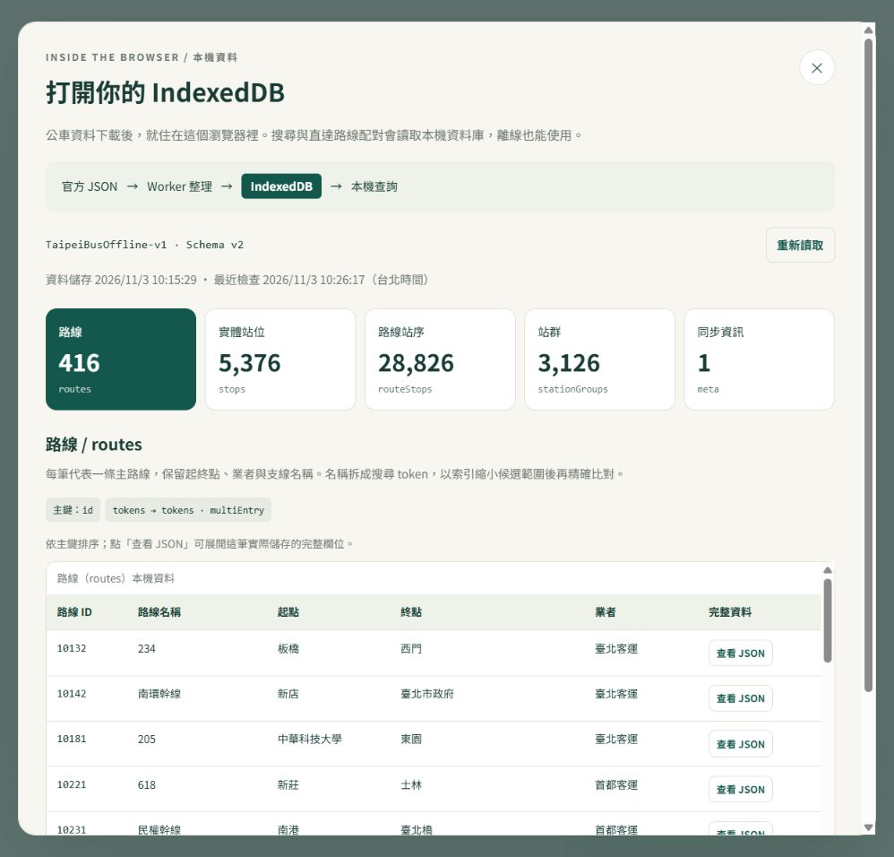
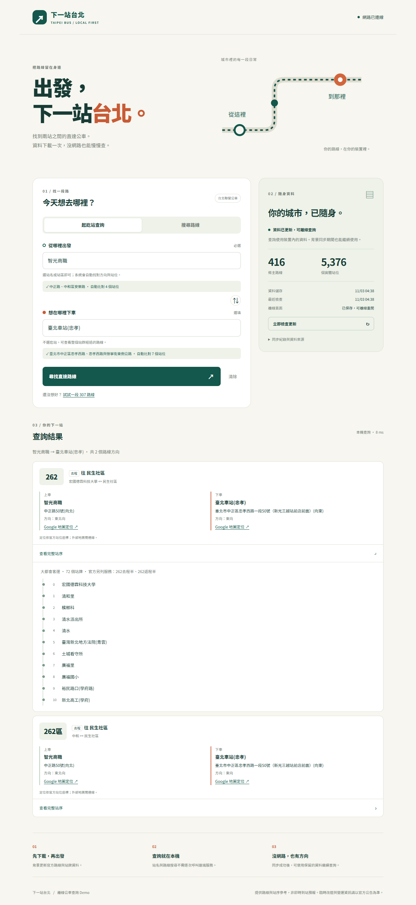
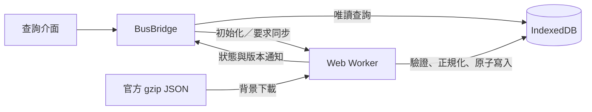

# 下一站台北｜IndexedDB × Web Worker 公車查詢 Demo

**[開啟線上 Demo](https://meteor950187.github.io/IndexedDB-Demo/)** · 使用 GitHub Pages 靜態託管，首次開啟需連線下載官方資料。

本專案將過去專案中 **IndexedDB 與 Web Worker 一起使用的開發內容提取出來，再透過 AI 重新整理資料來源、資料處理流程與呈現方式**，以臺北聯營公車開放資料作為新的應用情境，做出這個 Demo 作品。

延續的核心做法，是由 Worker 在背景同步資料，將整理後的內容儲存在瀏覽器的 IndexedDB，再由前端直接查詢本機資料。本次以公車路線、站位與站序重新設計資料模型，並加入站群選擇、直達路線查詢及快取資料檢視，讓原本藏在程式內部的資料處理流程，可以透過實際操作呈現。

這是一個用於作品集與面試展示的原生 JavaScript 專案，重點在於 **瀏覽器端的資料管理、背景同步、索引查詢，以及離線使用的完整流程**。

## 專案可以展示什麼？

| 展示面向 | 實際功能 |
|---|---|
| 資料取得與整理 | 下載官方 gzip JSON，由 Worker 解壓、驗證、正規化，再寫入 IndexedDB |
| 本機資料查詢 | 透過 IndexedDB 索引搜尋站名與路線，並依路線、方向及站序配對直達行程 |
| 資料模型與使用體驗 | 將附近同名站位整理為站群，使用者選站名後，由程式找出適合的上下車站位 |
| 離線與更新處理 | 已儲存資料可先供查詢；背景更新失敗時保留前版，頁面也能在完成快取後離線重新開啟 |
| 可觀察的儲存內容 | 從「查看快取資料」開啟視窗，直接瀏覽資料表、實際筆數、索引與完整 JSON |

### 查看 IndexedDB 裡的資料

頁首的「查看快取資料」可切換五張資料表，分頁瀏覽資料並展開單筆 JSON。筆數透過 object store 的 `count()` 取得，主鍵與索引資訊則讀自資料庫 schema；畫面呈現的是當下瀏覽器實際儲存的內容。

這個介面讓展示者可以從一筆路線資料，接著說明它的搜尋 token、索引與本機查詢方式，也能直接對照同步時間及資料版本。



<details>
<summary>查看公車查詢畫面</summary>



</details>

## 技術設計

使用 HTML、CSS 與原生 JavaScript ES Modules，搭配 IndexedDB、Web Worker、Service Worker、Web Locks 與 BroadcastChannel。應用程式直接讀取公開資料檔，本機 Node.js server 負責提供靜態檔案。



### 1. Web Worker：背景同步與資料整理

Worker 負責下載三份官方資料、處理解壓縮與欄位正規化，並計算內容的 SHA-256 摘要。若資料內容沒有改變，只更新檢查時間；有變更時，才以單一 transaction 替換整批資料。

有既有快取時，介面可先開放查詢，再進行背景同步。同步支援下載逾時、失敗退避重試與定期檢查；同一分頁的重複同步要求會合併，支援 Web Locks 的瀏覽器也會協調跨分頁同步。

### 2. IndexedDB：資料模型、索引與一致性

資料以五個 object store 儲存：

| Object store | 儲存內容 | 索引 |
|---|---|---|
| `routes` | 主路線名稱、起終點、業者、支線／別名 | `tokens`，multiEntry |
| `stops` | 實體站位名稱、地址、經緯度、方位 | `tokens`，multiEntry |
| `routeStops` | 路線與站位關聯、去返程、停靠順序 | `stop`；`routeDirection` 複合索引 |
| `stationGroups` | 站群及其成員、道路站區階層 | `tokens`、`stop`，皆為 multiEntry |
| `meta` | 資料版本、來源時間、同步時間與筆數 | 以主鍵 `current` 直接讀取 |

名稱搜尋會先以單字／相鄰兩字組成的 token 索引縮小候選範圍，再做完整比對與排序。每個名稱及別名獨立比對；純數字需符合完整數字段，因此搜尋 `262` 可找到 `262`、`262區`，不會因字串拼接而誤命中 `26` 或 `226`。

直達查詢透過站位索引取得相關路線，再檢查「相同路線、相同方向、上車站序早於下車站序」。一次查詢所需資料在同一個唯讀 transaction 中取得，展開站序時也會比對資料版本。背景更新以原子交易提交，避免新舊資料混用；schema 升級則能由既有快取建立站群，不必刪除資料庫重新下載。

### 3. BusBridge：介面與同步生命週期的入口

Bridge 封裝 Worker 的初始化、訊息往返、同步狀態與查詢入口。介面透過 Bridge 讀取 IndexedDB；下載與資料整理則交給 Worker 執行。

跨分頁資料更新透過 BroadcastChannel 通知，介面會讓舊結果失效。快速輸入、交換起訖或切換查詢模式時，也以操作版本避免較晚回傳的舊結果覆蓋新選擇。

### 4. HTTP 快取、IndexedDB 與離線頁面的分工

| 機制 | 在本專案的用途 |
|---|---|
| HTTP 快取 | 下載使用 `cache: 'default'`，由瀏覽器依來源 HTTP headers 決定是否使用快取 |
| IndexedDB | 儲存整理後的公車資料，供索引搜尋與行程配對使用 |
| Service Worker ＋ Cache Storage | 保存 HTML、CSS、JavaScript 等頁面檔案，支援離線重新開啟 |

「資料可離線查詢」與「頁面可離線開啟」分別由 IndexedDB 與 Service Worker 配合完成。資料檔與頁面檔案各有其更新流程；HTTP／CDN 快取成效則取決於來源與部署設定，本專案沒有量測 CDN 命中率。

## 從資料模型到操作體驗

同一個站名可能有多個實體站位，且去返程停靠的位置不同。例如智光商職與臺北車站忠孝，都不能只用一個固定站位代表使用者的起訖需求。

本專案將附近同名站位整理為站群，保留忠孝、公園等道路站區，也提供明確標示的「全部站區」選項。選定起訖後，程式自動比對群內站位，顯示實際上下車地址、方向與 Google Maps 座標連結；交換起訖時重新評估有效組合。

分組採保守的距離界限：同名站群所有成員兩兩直線距離不超過 400 公尺，上層站區不超過 900 公尺。每條路線、每個方向整理為一張結果卡，並保留可用的替代上下車位置。

## 資料來源

資料由臺北市公共運輸處提供，使用[臺北市資料大平臺的公車資料集](https://data.taipei/dataset/detail?id=6a03b03d-90d1-4d9e-a952-c940fd869772)：

| 檔案 | 用途 |
|---|---|
| [GetRoute.gz](https://tcgbusfs.blob.core.windows.net/blobbus/GetRoute.gz) | 路線、業者及路徑名稱 |
| [GetStop.gz](https://tcgbusfs.blob.core.windows.net/blobbus/GetStop.gz) | 路線與站位關聯、方向及站序 |
| [GetStopLocation.gz](https://tcgbusfs.blob.core.windows.net/blobbus/GetStopLocation.gz) | 實體站位名稱、地址及座標 |

三份檔案皆為 gzip 壓縮的 JSON，採全量下載後整理成查詢模型；只保留本專案需要的欄位及有路線關聯的站位。資料範圍依這組官方來源，並非全臺灣所有公車。

2026-11-03 驗證快照整理後有 **416 條主路線、5,376 個實體站位、28,826 筆路線站序**；實際筆數會隨官方更新而改變。來源時間與智光商職行程的逐筆對照見 [資料驗證紀錄](docs/verification.md)。

## 本機執行

需要 **Node.js 22 以上**。應用程式沒有前端建置步驟，啟動靜態 server 即可：

```bash
npm start
```

開啟 [http://127.0.0.1:4173](http://127.0.0.1:4173)。首次使用需連線下載官方資料；請透過 localhost 開啟，不使用 `file://`。

### 建議展示流程

1. 等待資料載入，點「查看快取資料」，說明五張資料表、索引與單筆 JSON。
2. 查詢「智光商職 → 臺北車站(忠孝)」，查看直達路線與實際上下車位置；本次驗證資料可查到 262、262區。
3. 交換起訖站再查詢，觀察反向使用不同站位；展開卡片查看完整站序。
4. 切換到路線搜尋，輸入 `262`，展示完全相符優先及支線區分。
5. 確認「離線頁面」顯示已保存，在瀏覽器 DevTools 切換 Offline 後重新整理，展示本機查詢與快取內容。

## 測試與驗證

```bash
npm ci
npm test
```

目前有 **15 個自動測試通過**，涵蓋名稱匹配、站群與方向配對、索引與快取檢視、資料庫遷移、原子寫入及失敗保留資料。

另以真實瀏覽器驗證正反向行程、快速操作、桌面與手機畫面、同步失敗恢復、跨分頁更新及舊版升級後的離線查詢。測試範圍與證據見 [驗證紀錄](docs/verification.md)；重跑瀏覽器腳本及部署方式見 [開發與驗收指南](docs/development.md)。

## 程式碼導覽

| 檔案 | 職責 |
|---|---|
| `app/bridge.js` | Worker 生命週期、訊息協調與查詢入口 |
| `app/worker.js`、`app/sync.js` | 背景同步、重試、解壓驗證與整批更新 |
| `app/db.js` | schema、索引、遷移與交易查詢 |
| `app/model.js`、`app/groups.js`、`app/search.js` | 官方資料轉換、站群與搜尋規則 |
| `app/ui.js`、`app/cache-viewer.js` | 查詢介面與 IndexedDB 展示視窗 |
| `sw.js` | 頁面檔案快取與版本更新 |
| `tests/` | 資料層回歸測試與瀏覽器驗收腳本 |

原始 `GameCodeBridge.js`、`workerByJson.js`、`workerSiteSetting.js` 保留在儲存庫中，作為本次提取與重新整理的起點；目前 Demo 的執行入口位於 `app/`。

## 專案範圍

本作品提供路線與站序查詢，不包含即時到站、即時車輛位置、完整班次時刻表、票價或轉乘規劃。站群採直線距離分組，地圖連結提供定位，不代表已計算步行路徑。

官方檔案各自更新，地址或營運標示可能存在差異；本機交易可保證整批提交的一致性，無法補足來源未提供的即時狀態。離線資料保留也受到瀏覽器儲存空間與使用者清除網站資料的影響。實際瀏覽器驗證以 Chromium 為主。
